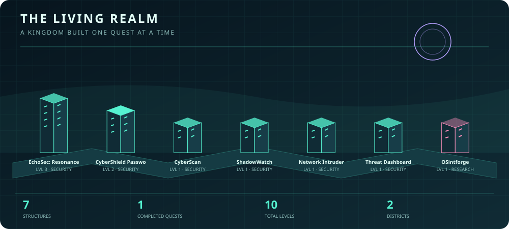

 <div align="center">


<br><br>

**I turn ideas into practical tools, interactive experiences, and systems people can explore.**

*Building at the intersection of cybersecurity, artificial intelligence, automation, and creative engineering.*

</div>

---

## `> SYSTEM PROFILE`

```yaml
alias: RudraNoir
role: Cybersecurity & AI Builder

focus:
  - Defensive cybersecurity
  - AI-powered desktop automation
  - Threat detection and incident response
  - Interactive security simulations
  - Python security engineering

currently_building:
  - DIABLO: Windows AI Operator
  - EchoSec: Resonance Protocol
  - Defensive security utilities
  - Interactive cybersecurity laboratories

philosophy: Build. Experiment. Test. Improve. Ship.
```

I enjoy taking technical concepts and turning them into working projects. My interests include defensive security, system intelligence, authentication safety, anomaly detection, network monitoring, AI-assisted automation, and security education.

My primary tools are **Python, JavaScript, HTML, CSS, Git, and PowerShell**.

---

## `> FEATURED OPERATIONS`

### ⚡ EchoSec: Resonance Protocol


A cinematic, browser-based cybersecurity incident-response experience. Players investigate incidents, analyze evidence, operate a simulated security terminal, earn XP, and progress through missions.

**Core systems**
- Interactive incident-response decisions
- Brute-force investigation
- Simulated cyber terminal
- Phishing evidence analysis
- Mission grading and XP progression
- Saved browser progress

**Security concepts**
- Authentication monitoring
- Log investigation
- Email authentication
- Threat containment
- Evidence preservation
- Least-disruptive response

<div align="center">

[](https://github.com/rudranoir0-dot/echosec-resonance-protocol)
[](https://rudranoir0-dot.github.io/echosec-resonance-protocol/)

</div>

### ⚙️ DIABLO: Windows AI Operator


An evolving Python-powered AI operator designed to interact with the Windows environment through specialized tools.

DIABLO aims to move beyond ordinary conversational assistance toward practical computer operations, system awareness, intelligent file management, and eventually controlled multi-step desktop automation.

**Implemented systems**
- AI provider integration with Gemini and Groq
- System resource and process monitoring
- Application discovery and management
- File creation, search, copying, moving, and organization
- Duplicate-file identification
- File audits and storage intelligence
- Document extraction and three-layer document search
- Restricted file access and read-only analysis workflows

**Development direction**
- Multi-step workflow engine
- Screen awareness and desktop interaction
- Advanced file organization
- Defensive cybersecurity capabilities

<div align="center">

[](https://github.com/rudranoir0-dot/DIABLO-Windows-AI-Operator)

</div>

---

## `> SECURITY PROJECTS`

| Project | Purpose | Technology |
|---|---|---|
| [**EchoSec: Resonance Protocol**](https://github.com/rudranoir0-dot/echosec-resonance-protocol) | Interactive incident-response simulation | JavaScript, HTML, CSS |
| [**DIABLO: Windows AI Operator**](https://github.com/rudranoir0-dot/DIABLO-Windows-AI-Operator) | AI-powered Windows operations and system intelligence | Python, Gemini, Groq |
| [**CyberShield Password Toolkit**](https://github.com/rudranoir0-dot/cybershield-password-toolkit) | Password-strength analysis and secure password generation | Python, pytest |
| [**CyberScan**](https://github.com/rudranoir0-dot/cyberscan) | Defensive scanning, URL checks, WHOIS analysis, and reporting | Python |
| [**ShadowWatch**](https://github.com/rudranoir0-dot/shadowwatch) | Behavioral anomaly detection and impostor identification | Python |
| [**Network Intruder**](https://github.com/rudranoir0-dot/Network-Intruder) | Detect unknown devices on a monitored network | Python |
| [**Threat Dashboard**](https://github.com/rudranoir0-dot/Threat-Dashboard) | Security-event and threat-monitoring dashboard | Python |
| [**OSintforge**](https://github.com/rudranoir0-dot/OSintforge) | Digital-footprint investigation and OSINT learning | Python |

> Projects are intended for defensive security, education, authorized testing, and responsible research.

---

## `> TECH ARSENAL`

<div align="center">


<br><br>


</div>

---

## `> CURRENT OPERATIONS`

```text
[COMPLETE] CyberShield password checker
[COMPLETE] Secure password generator
[COMPLETE] Automated pytest suite

[COMPLETE] EchoSec Ghost Login mission
[COMPLETE] EchoSec cyber terminal
[COMPLETE] False Signal phishing mission
[ACTIVE]   Black Archive ransomware mission

[COMPLETE] DIABLO initial GitHub release
[ACTIVE]   DIABLO Windows AI Operator development

[ACTIVE]   Defensive security experiments
[PLANNED]  More interactive security laboratories
[PLANNED]  Advanced AI-powered automation
```

---

## `> DEVELOPMENT PRINCIPLES`

```text
01. Build tools that solve real problems.
02. Make security concepts understandable through interaction.
03. Keep testing authorized and defensive.
04. Prefer working functionality over empty demonstrations.
05. Design systems with safety and reliability in mind.
06. Document, test, iterate, and improve.
07. Ship projects instead of leaving ideas unfinished.
```

---

## ⟡ THE LIVING REALM

<div align="center">

*A kingdom that grows as you build.*



</div>

<!-- PROJECTS:START -->
| Project | District | Level | Status |
|---|---|---:|---|
| [EchoSec: Resonance Protocol](https://github.com/rudranoir0-dot/echosec-resonance-protocol) | Security | 3 | In progress |
| [DIABLO: Windows AI Operator](https://github.com/rudranoir0-dot/DIABLO-Windows-AI-Operator) | Automation | 1 | In progress |
| [CyberShield Password Toolkit](https://github.com/rudranoir0-dot/cybershield-password-toolkit) | Security | 2 | Completed |
| [CyberScan](https://github.com/rudranoir0-dot/cyberscan) | Security | 1 | In progress |
| [ShadowWatch](https://github.com/rudranoir0-dot/shadowwatch) | Security | 1 | In progress |
| [Network Intruder](https://github.com/rudranoir0-dot/Network-Intruder) | Security | 1 | In progress |
| [Threat Dashboard](https://github.com/rudranoir0-dot/Threat-Dashboard) | Security | 1 | In progress |
| [OSintforge](https://github.com/rudranoir0-dot/OSintforge) | Research | 1 | Planned |
<!-- PROJECTS:END -->

The realm is generated from [`project-registry.json`](project-registry.json). Registered projects become structures; published releases from connected repositories can upgrade their buildings.

- [Connect other project repositories](docs/CONNECTING_PROJECTS.md)
- [View the project registry](project-registry.json)

> The registry is the source of truth. The SVG and table are generated outputs.

---

## `> CONNECT`

<div align="center">

[](https://github.com/rudranoir0-dot)
[](mailto:rudranoir0@gmail.com)

<br><br>

```text
// BUILD SECURELY
// LEARN CONTINUOUSLY
// SHIP SOMETHING REAL
```

<sub>Cybersecurity projects are created for education, defensive research, authorized testing, and security-awareness training.</sub>

</div>
